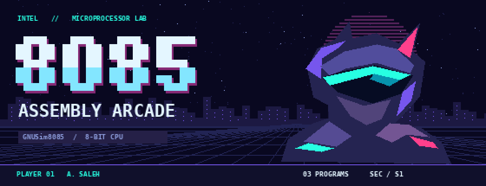
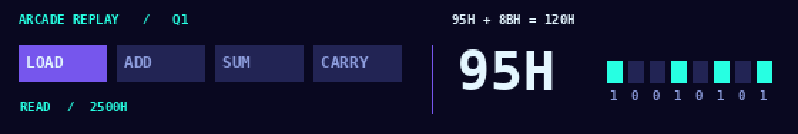

# Intel 8085 Assembly Assignment

**Student:** Abdelrahman Ahmed Saleh  
**Student ID:** 2025000457  
**Section:** S1

## Select a program

| File | Operation |
| --- | --- |
| [`q1_add_carry.asm`](./q1_add_carry.asm) | Adds two unsigned bytes and stores the low byte and carry separately. |
| [`q2_complement.asm`](./q2_complement.asm) | Inverts the input bits for the one's complement, then adds one for the two's complement. |
| [`q3_even_odd.asm`](./q3_even_odd.asm) | Reads the length and checks bit 0 of each element. A clear bit counts as even, including zero. |

## Arcade replay · The carry flag

The full sum is `120H`. The accumulator holds the low eight bits, `20H`. The carry flag holds the ninth bit, which the program saves as `01H`.

## Testing in GNUSim8085

Open and assemble one source file at a time. Leave **Load me at** empty to use the default program start address of `4200H`. Before executing, enter the input bytes in memory at the indicated addresses. Run until HLT, then inspect the output addresses. For another case, restart the program at its first instruction and enter the new inputs before running.

All addresses and byte values below are hexadecimal. For each row, enter the input bytes in consecutive addresses starting at 2500H.

| Program | Input bytes starting at 2500H | Expected output bytes |
| --- | --- | --- |
| Q1 | 25 14 | 2502H = 39, 2503H = 00 |
| Q1 | 95 8B | 2502H = 20, 2503H = 01 |
| Q2 | 5A | 2501H = A5, 2502H = A6 |
| Q2 | 0F | 2501H = F0, 2502H = F1 |
| Q3 | 06 12 07 24 0F 00 2A | 2600H = 04, 2601H = 02 |
